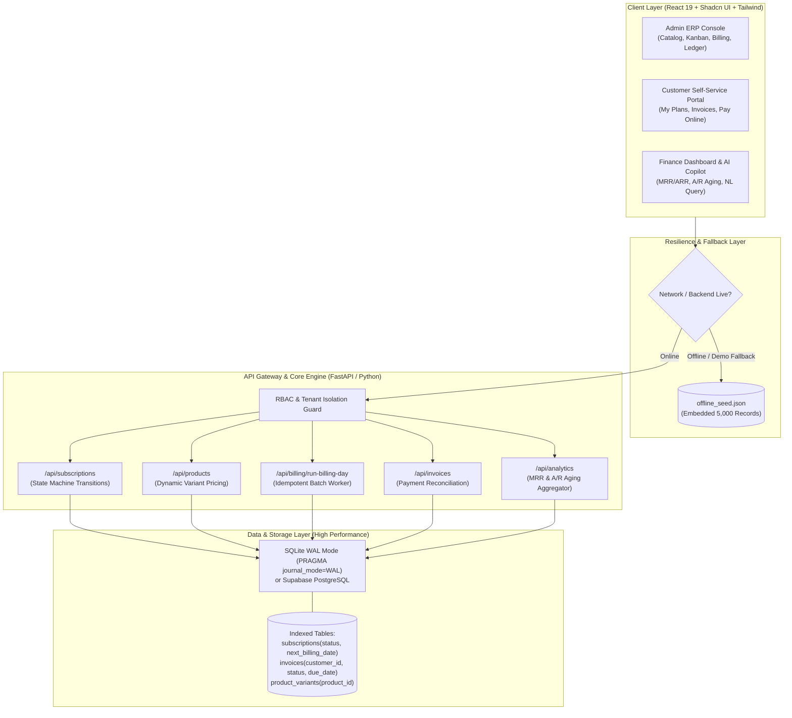
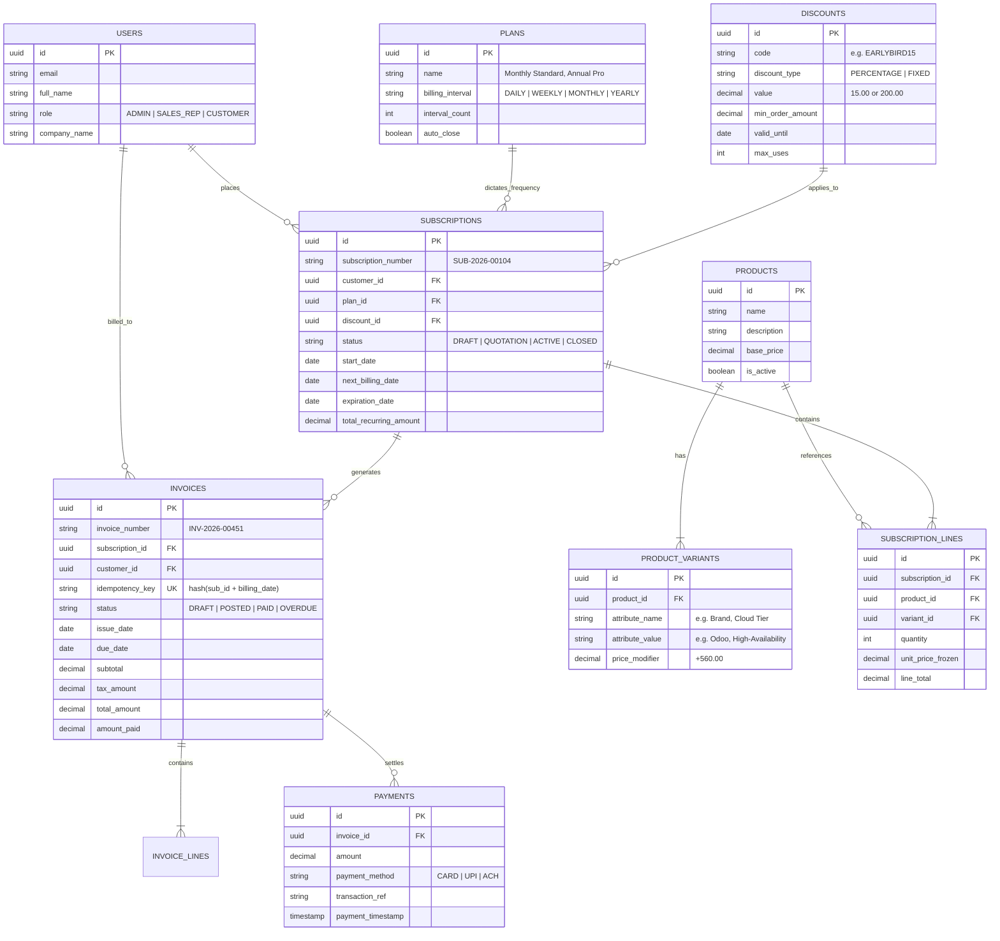
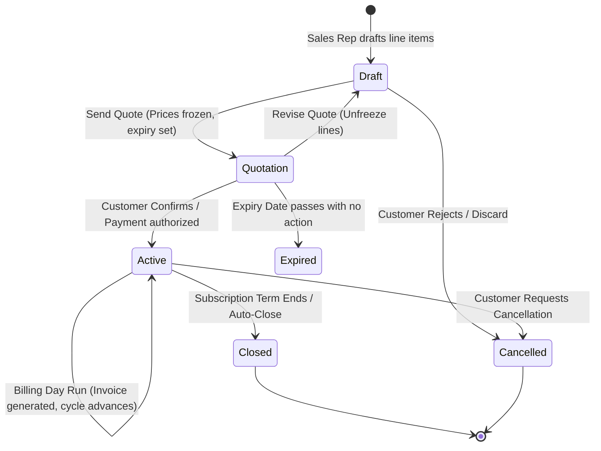
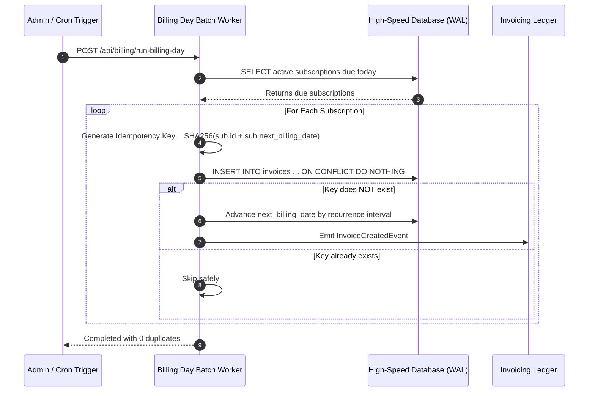

# Brightloop Software: Subscription Management System

> Enterprise-grade Quote-to-Cash platform for subscription lifecycle management, recurring billing, tax automation, invoice reconciliation, and executive finance analytics.

## System Overview

Brightloop Software is designed to eliminate revenue leakage, reduce manual billing mistakes, enforce zero double-billing guarantees, and give finance teams real-time visibility into subscription performance.

The platform models a modern SaaS billing stack inspired by Odoo-style subscription modules, but adapted for fast delivery in a hackathon or product prototype environment. The architecture emphasizes speed, correctness, observability, and resilience.

### Target Problem
- Prevent subscription revenue leakage
- Eliminate spreadsheet-based billing errors
- Guarantee idempotent billing behavior
- Reduce invoicing delays and payment inconsistencies
- Provide a clean admin and customer experience with secure access control

---

## 1. Core Functional Modules

Brightloop automates the full recurring revenue lifecycle across 8 interconnected modules:

| Module | Purpose | Key Capability |
| --- | --- | --- |
| 1. Product & Variants | Product catalog definition | Base pricing and configurable attribute modifiers |
| 2. Plans & Frequencies | Billing cadence management | Daily, weekly, monthly, yearly subscriptions |
| 3. Quotation & State Machine | Quote-to-subscription flow | Draft → Quote → Confirmed → Active → Closed |
| 4. Batch Billing Engine | Automated recurring charges | Due-date billing with idempotency protection |
| 5. Tax & Discount Engine | Pricing logic | Percentage/fixed discounts, tax validation, thresholds |
| 6. Payment & Invoicing Ledger | Invoice and payment processing | PDF invoices, due dates, payment reconciliation |
| 7. Dual Portal Access | Experience layers | Admin ERP + customer self-service portal |
| 8. Executive Finance Hub | Metrics and insights | MRR, ARR, A/R aging, AI financial copilot |

### Module Details

#### 1) Product & Variant Catalog
- Base products represent sellable goods and SaaS services
- Variant attributes add dynamic pricing modifiers, such as:
  - Brand: Odoo +$560
  - Cloud Tier: High Availability +$250
  - User Tier: 10-Seat Pack +$180

#### 2) Subscription Plans & Billing Frequencies
- Supports recurring rhythms: Daily, Weekly, Monthly, Yearly
- Supports grace periods, auto-close policies, and renewal scheduling
- Subscription plan configuration controls recurring billing behavior

#### 3) Quotation & Subscription Lifecycle
- Draft: sales rep builds a quote and line items
- Quotation: pricing is frozen, discount/tax is finalized, and approval expiry is enforced
- Confirmed / Active: live recurring subscription is created and billing begins
- Closed / Cancelled: orderly termination with proration and audit trail

#### 4) Automated Billing Day Engine
- Runs a batch job to find all `ACTIVE` subscriptions whose `next_billing_date <= today`
- Creates invoice records automatically
- Advances billing date based on recurrence interval
- Logs invoice creation and subscription state progression

#### 5) Dynamic Tax & Discount Engine
- Supports fixed and percentage discounts
- Enforces minimum spend thresholds
- Applies date validity checks
- Automatically calculates tax based on configured rules after discount adjustment

#### 6) Invoicing & Payment Collection Ledger
- Produces invoice records with invoice number, line items, discounts, taxes, and balances
- Tracks invoice states from Draft → Posted → Paid / Overdue / Cancelled
- Records payment method, transaction ID, and payment reconciliation

#### 7) Dual-Portal RBAC Experience
- Admin ERP: commercial operations, billing admin, finance, pricing control
- Customer Portal: limited to tenant-owned records and invoice visibility
- Role restrictions enforce ownership and segregation of authority

#### 8) Finance Dashboard & AI Copilot
- Real-time MRR and ARR calculations
- A/R aging buckets for current, 31–60, 61–90, and 90+ overdue invoices
- Natural-language finance queries for executive insight

---

## 2. System Architecture & Topology



### Architectural Principles
- Deterministic data processing
- Clear tenant boundaries
- Fast read/write query paths
- Offline-safe frontend experience
- Explicit audit logging on billing events

---

## 3. Database Model



### Key Indexes
```sql
CREATE INDEX idx_subs_billing ON subscriptions(status, next_billing_date);
CREATE INDEX idx_invoices_aging ON invoices(status, due_date, customer_id);
CREATE INDEX idx_variant_lookup ON product_variants(product_id, attribute_name);
```

---

## 4. Technical Mechanics

### A. Dynamic Variant Pricing
The pricing engine computes line and order totals using the following logic:

```text
Line Unit Price = Product Base Price + Sum(Variant Modifiers)
Line Subtotal = Line Unit Price × Quantity
Order Subtotal = Sum(Line Subtotals)
Discount Amount = Percentage or Fixed Discount applied to subtotal
Tax Amount = (Order Subtotal - Discount Amount) × Tax Rate
Total Invoice Amount = (Order Subtotal - Discount Amount) + Tax Amount
```

Example:
- Base software: $1,200
- Odoo brand variant: +$560
- Final unit price: $1,760
- Discount: 10% = -$176
- Tax: 18% = +$285.12
- Final billable total: $1,869.12

### B. Subscription State Machine



State transition guards:
1. `Draft` cannot become `Active` without first becoming `Quotation`
2. Expired or Closed subscriptions cannot be billed
3. Once active, subscription pricing is immutable until a new amendment quote is created

### C. Deterministic Batch Billing Engine
The most important failure mode in recurring billing is duplicate invoicing during retries. Brightloop solves this with database-level idempotency.



This design guarantees zero duplicate invoices even when the billing job is retried multiple times.

### D. MRR Normalization
Subscriptions may recur daily, weekly, monthly, or yearly. To compare them fairly, revenue is normalized into a standard monthly metric.

```text
MRR = Σ (subscription_amount × billing_multiplier)
```

Multipliers:
- Daily: × 30.417
- Weekly: × 4.333
- Monthly: × 1.000
- Yearly: ÷ 12.000

`ARR = MRR × 12`

### E. A/R Aging Mechanics
Outstanding invoices are classified based on the number of days overdue:

```text
Days Overdue = max(0, current_date - invoice.due_date)
```

Buckets:
- Current: 0–30 days
- 31–60 days: warning
- 61–90 days: high-risk
- 90+ days: delinquent / collections risk

### F. Performance SLA Strategy
The architecture targets high-speed analytics and billing operations even on moderate data volumes.

1. SQLite WAL mode for concurrent reads/writes
2. Compound indexes for billing and aging queries
3. Single-pass aggregation for dashboard metrics
4. Cache-friendly SQL patterns and lightweight API responses

---

## 5. Security & Multi-Tenant Authorization

```text
Incoming HTTP Request
        │
        ▼
JWT Bearer / Session Token
        │
        ├── Role: ADMIN / STAFF
        │       └── Full ERP and billing access
        │
        └── Role: CUSTOMER
                └── Strict row-level access
                    ├── Can view own subscriptions
                    ├── Can pay own invoices
                    └── Cannot access other tenants
```

### Security Model
- JWT or session-based authentication
- RBAC with distinct admin and customer permissions
- Tenant isolation enforced at data access boundaries
- API routes validate ownership before mutation
- Payment and billing actions are restricted by role and account scope

---

## 6. Zero-Fail Offline Resilience

To protect user experience during network instability or backend failure, the frontend uses a dual-mode client strategy.

```typescript
import { offlineSeedData } from "./offline_seed";

export async function fetchSubscriptions() {
  if (localStorage.getItem("DEMO_MOCK_MODE") === "true") {
    return offlineSeedData.subscriptions;
  }

  try {
    const res = await fetch("/api/subscriptions", { timeout: 1500 });
    if (!res.ok) throw new Error("API Offline");
    return await res.json();
  } catch (err) {
    console.warn("API unreachable. Engaging Zero-Fail Mock Mode.");
    return offlineSeedData.subscriptions;
  }
}
```

### Demo Safety Guarantee
If the live server fails or connectivity is intermittent, the system can instantly fall back to embedded mock data without breaking the demo experience.

---

## 7. Recommended Tech Stack

- Frontend: React 19, Shadcn UI, Tailwind CSS
- Backend: FastAPI, Python
- Database: SQLite WAL or Supabase PostgreSQL
- Auth: JWT / session-based RBAC
- Analytics: SQL aggregation, dashboard summaries, real-time metrics
- Resilience: offline mock mode and graceful fallback UI

---

## 8. Why This Architecture Works

Brightloop is intentionally built around four principles:

- Correctness: billing is deterministic and idempotent
- Trust: invoices are tied to immutable billing events and audit logs
- Speed: queries are indexed and dashboard calculations are efficient
- Resilience: the UI remains usable even under failed network conditions

This makes the system practical for both production-grade subscription management and rapid hackathon delivery.

---

## 9. Summary

Brightloop Software is a complete subscription management system spanning product catalog, pricing, billing, payments, invoicing, customer access, and financial intelligence. It is designed to be fast, secure, resilient, and mathematically consistent under recurring billing workloads.

The architecture combines a clean state-machine-driven workflow with a scalable SQL data model, idempotent billing enforcement, and a customer-safe operational experience.

---

## Project Status

This repository currently documents the system architecture and execution model for a subscription platform designed to satisfy the core requirements of an enterprise recurring billing product.


## 💻 Frontend Working Prototype (Odoo Enterprise Light UI)
The complete 13-Screen Odoo 17/18 Enterprise Light Theme ERP suite for Brightloop Subscription Management System is located in **[`frontend/`](frontend/)**:
- **[frontend/index.html](frontend/index.html)**: 13-screen suite structure (Login, Executive Dashboard, Invoicing, Subscriptions Kanban & List, Automated Batch Billing, Products, Pivot, Settings, and Customer Portal).
- **[frontend/style.css](frontend/style.css)**: Official Odoo purple & teal light theme design system.
- **[frontend/app.js](frontend/app.js)**: Full MVC controller with authentication, dynamic state transitions, Chart.js visualizers, and batch renewal engine.
