# Make-A-Ton Universal Grand-Prize Winning Playbook

> **Event Context**: Make-A-Ton is South India's premier 24-hour national hackathon hosted by CITTIC CUSAT at Cochin University of Science and Technology. Juries include startup founders, senior architects, CITTIC incubation directors, and corporate engineering leads (e.g., Odoo).
>
> This playbook distills the architectural choices, commit patterns, presentation tactics, and engineering shortcuts extracted directly from **77 historical projects** across Make-A-Ton 2025 and Make-A-Ton 7.0.

---

## 🕒 The 24-Hour Master Timeline

```mermaid
gantt
    title Make-A-Ton 24-Hour Championship Sprint
    dateFormat  HH:mm
    axisFormat  %H:%M
    section Ideation & Scaffolding
    Problem Validation & Track Selection :00:00, 02:00
    15-Minute Scaffolding & Hello-World Pipeline :02:00, 03:30
    section Core Engineering
    MVP Core Logic (AI/IoT/Web3/CV) :03:30, 11:00
    UI Integration & Glassmorphic Dashboard :11:00, 15:00
    section Hardening & Demo
    Zero-Fail Offline Fallback Architecture :15:00, 18:00
    Edge-Case Elimination & Polish :18:00, 20:00
    section Pitch & Defense
    180-Second Pitch Scripting & Slide Deck :20:00, 22:30
    Jury Q&A Rehearsal & Devpost/Repo Submission :22:30, 24:00
```



---

## 🎯 Phase 0: The Make-A-Ton Ideation & Selection Gate (Hours 0 – 2)

Winning hackathons is 50% problem selection. Most losing teams build generic todo apps, basic wrappers around an LLM API, or unprovable theoretical platforms.

### The 5 Litmus Tests for a Winning Project Idea
Every winning project (*Tinkerbluds*, *Secure.sol*, *VigilX*, *OPTIMA*, *COG AI*) passes all five criteria:

1. **Visceral Pain Point**: Can the problem be stated in 1 sentence that makes an engineer or business judge instantly wince?
   - *Weak*: "A portal to help people learn better."
   - *Winning*: "Women with PCOS lack multi-physiological signal tools to predict anovulatory cycles, leaving millions misdiagnosed." (*PCO-US*)
2. **Deep Technical Hook (Not Just a Wrapper)**:
   - Does it integrate multi-modal AI, real-time computer vision, hardware telemetry, EVM static bytecode analysis, or satellite data?
   - If the entire project can be duplicated by a 20-line Python script calling `openai.chat.completions.create`, **reject it immediately**.
3. **High-Impact Visual Tangibility**:
   - Can a spectator standing 5 feet away instantly see real-time changes on screen (e.g., live bounding boxes, heatmaps, interactive charts, sensor gauges)?
4. **Local / Regional Relevance (The CUSAT Advantage)**:
   - Make-A-Ton judges love solutions addressing agricultural distress (coconut grading, cultivated land validation), campus life (Cusatify), transportation (*Traq*), or healthcare accessibility (*CrticaLink*).
5. **Clear 24-Hour Feasibility**:
   - The core pipeline must be fully demonstrable in 180 seconds without requiring 4 hours of model training or unavailable enterprise permissions.

---

## ⚡ Phase 1: The 15-Minute Rapid Scaffolding Engine (Hours 2 – 3:30)

Do not spend 3 hours debating project structures. Deploy this exact high-velocity architecture, proven across 57 analyzed repositories:

### Directory Structure
```
project-root/
├── frontend/                     # React 19 + Vite + TailwindCSS + Shadcn UI
│   ├── src/
│   │   ├── components/ui/        # Radix UI primitives (Button, Card, Dialog, Badge)
│   │   ├── components/dashboard/ # Hackathon dashboard widgets
│   │   ├── hooks/useMockMode.ts  # Zero-Fail Offline Simulator toggle
│   │   ├── lib/utils.ts          # cn() helper
│   │   ├── App.tsx
│   │   └── main.tsx
│   ├── package.json
│   └── vite.config.ts
├── backend/                      # Python 3.11+ FastAPI (Async + Streaming)
│   ├── app/
│   │   ├── api/routes.py         # REST & WebSocket endpoints
│   │   ├── core/config.py        # Environment variables & Mock flags
│   │   ├── services/             # AI, CV, or Scraper logic
│   │   └── data/mock_seeds.json  # Pre-computed high-fidelity backup responses
│   ├── main.py
│   └── requirements.txt
├── hardware/                     # (Optional) Arduino / ESP32 firmware
│   └── esp32_telemetry.ino
├── docker-compose.yml            # One-command local setup
└── README.md                     # Clean project documentation with architecture diagram
```

---

## 🛠️ Phase 2: Core Engineering Patterns & Architectural Trade-offs (Hours 3:30 – 14)

### 1. Computer Vision & MediaPipe (Edge Zero-Lag Pattern)
- **Do NOT** send raw 1080p video frames over HTTP to the backend for every frame (causes 600ms latency and frame dropping during demos).
- **DO** run landmark detection (MediaPipe / FaceMesh / HandPose) directly in the browser using `@mediapipe/camera_utils` or WebAssembly, OR send compressed 320x240 JPEG frames via WebSockets to a local OpenCV backend.
- **Reference**: Project *Mudra* (Yukti) & *VigilX* ran real-time 30 FPS inference by computing joint Euclidean distances locally.

### 2. Geospatial & Mapping (The Free Leaflet Pattern)
- **Anti-Pattern**: Using Google Maps JavaScript API (requires credit card, domain verification, and fails during local demo if credentials bounce).
- **Winning Pattern**: Use `leaflet` with OpenStreetMap or CartoDB Dark Matter tiles.

### 3. Real-Time Hardware / IoT Bridge (WebSerial & WebSockets)
- Use native browser **WebSerial API** to read USB serial output from ESP32/Arduino directly in React without needing an intermediary local server.

---

## 🛡️ Phase 3: The Zero-Fail Demo Architecture (Hours 15 – 18)

Every single service must support immediate local fallback (`useMockMode.ts`).
When network or third-party APIs fail during judge visits, the application seamlessly toggles to deterministic high-fidelity mock records without breaking character.

---

## 🎤 Phase 4: The 180-Second Winning Pitch Script (Hours 20 – 22:30)

```
[0:00 - 0:30]  HOOK & VISCERAL PROBLEM
[0:30 - 1:45]  THE UNBROKEN LIVE DEMO (75 Seconds)
[1:45 - 2:30]  ARCHITECTURE & ENGINEERING DEPTH
[2:30 - 3:00]  BUSINESS ROADMAP & CITTIC FEASIBILITY
```

---

## 🧠 Phase 5: The Jury Q&A Defense Matrix (Hours 22:30 – 24)
Includes deterministic answers for the top 5 questions on differentiation, monetization, offline usage, and 24-hour sprint scope.
