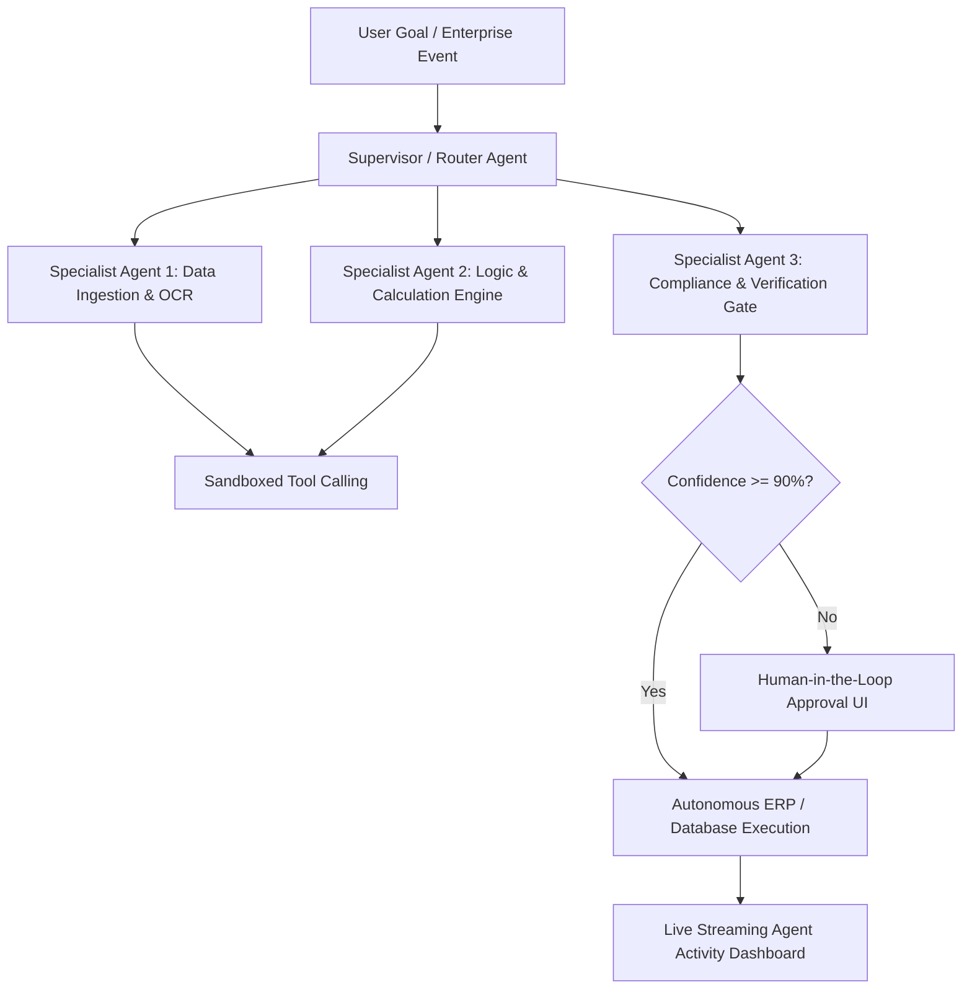

# Make-A-Ton 9.0: AI & Autonomous Agents Championship Playbook

> **Strategic Context**: Make-A-Ton 9.0 has partnered with **Odoo** as a flagship hiring hackathon. In modern hackathons, simple single-prompt LLM wrappers ("ChatGPT for X") are discarded by technical judges within 30 seconds.
>
> Winning projects in the AI track (*Agent Orange*, *MarketingWala*, *Snow*, *CropIntel*) execute **autonomous multi-agent workflows** where specialized agents collaborate, execute verified tools, maintain stateful memory, and operate with human-in-the-loop guardrails.

---

## 🏗️ The 4 Core Agentic Architectures for Make-A-Ton



### 1. The Supervisor-Worker Pattern (Recommended for Hackathons)
- A central Orchestrator LLM breaks complex goals into subtasks, delegates to specialized agents (e.g., Ingestion Agent, Audit Agent, Communication Agent), collects results, and enforces state schemas.
- **Why it wins**: Avoids single-agent context pollution and allows parallel tool execution.

### 2. Stateful Graph Execution (LangGraph / StateMachine)
- Represent the workflow as a finite state graph with explicit transition conditions.
- **Why it wins**: Eliminates infinite conversational loops and token drain. If an agent fails to call a tool properly, the graph directs it to a dedicated error-recovery node.

### 3. Human-in-the-Loop (HITL) Guardrail Gate
- Critical actions (releasing funds, deleting database rows, dispatching invoices, changing inventory) pause the agent graph and push an interactive approval card to the frontend.
- **Why it wins**: Enterprise judges (especially from Odoo) look for safety, compliance, and hallucination containment.

### 4. Live Agent Observability & Telemetry Streaming
- Never leave judges looking at a blank loading spinner for 15 seconds while agents reason.
- Stream agent thought processes, active tool invocations, and payload diffs in real time over WebSockets to an animated "Agent Swarm Visualizer" dashboard.

---

## ⚡ The 15-Minute Agentic Boilerplate (FastAPI + LangGraph / LiteLLM)

### Directory Layout
```
ai-agents-core/
├── backend/
│   ├── app/
│   │   ├── agents/
│   │   │   ├── supervisor.py     # Main routing logic
│   │   │   ├── researcher.py     # Document & web lookup agent
│   │   │   └── executor.py       # Tool execution & ERP update agent
│   │   ├── tools/
│   │   │   ├── erp_tools.py      # Odoo / SQLite transactional tools
│   │   │   └── mock_tools.py     # Zero-fail offline tool simulator
│   │   ├── core/
│   │   │   ├── state.py          # TypedDict agent state schema
│   │   │   └── streaming.py      # WebSocket event broadcaster
│   │   └── main.py               # FastAPI server
│   └── requirements.txt
└── frontend/
    └── src/components/agents/
        ├── AgentSwarmGraph.tsx   # Interactive visualization of active nodes
        └── HumanApprovalModal.tsx# Real-time interrupt & confirmation dialog
```

### 1. State Schema (`backend/app/core/state.py`)
```python
from typing import Annotated, List, Dict, Any, Optional
from typing_extensions import TypedDict
import operator

class AgentState(TypedDict):
    task: str
    active_agent: str
    plan: List[str]
    tool_history: Annotated[List[Dict[str, Any]], operator.add]
    intermediate_data: Dict[str, Any]
    requires_human_approval: bool
    final_output: Optional[str]
    error: Optional[str]
```

### 2. FastAPI WebSocket Streaming Server (`backend/app/main.py`)
```python
import json
import asyncio
from fastapi import FastAPI, WebSocket, WebSocketDisconnect
from fastapi.middleware.cors import CORSMiddleware
from app.core.state import AgentState

app = FastAPI(title="Make-A-Ton Autonomous Agent Swarm")

app.add_middleware(
    CORSMiddleware,
    allow_origins=["*"],
    allow_credentials=True,
    allow_methods=["*"],
    allow_headers=["*"],
)

class ConnectionManager:
    def __init__(self):
        self.active_connections: list[WebSocket] = []

    async def connect(self, websocket: WebSocket):
        await websocket.accept()
        self.active_connections.append(websocket)

    def disconnect(self, websocket: WebSocket):
        self.active_connections.remove(websocket)

    async def broadcast_agent_step(self, agent_name: str, thought: str, tool: str, payload: dict):
        event = {
            "type": "AGENT_STEP",
            "agent": agent_name,
            "thought": thought,
            "tool": tool,
            "payload": payload
        }
        for connection in self.active_connections:
            await connection.send_text(json.dumps(event))

manager = ConnectionManager()

@app.websocket("/ws/swarm")
async def websocket_swarm_endpoint(websocket: WebSocket):
    await manager.connect(websocket)
    try:
        while True:
            data = await websocket.receive_text()
            cmd = json.loads(data)
            
            # Start simulated or real multi-agent pipeline
            await manager.broadcast_agent_step(
                agent_name="Supervisor",
                thought="Decomposing user prompt into enterprise sub-actions...",
                tool="task_planner",
                payload={"subtasks": ["parse_rfq", "check_inventory", "draft_invoice"]}
            )
            await asyncio.sleep(1.0)
            
            await manager.broadcast_agent_step(
                agent_name="InventoryAgent",
                thought="Querying stock levels for SKU #49281...",
                tool="query_odoo_stock",
                payload={"sku": "49281", "available": 140, "allocated": 20}
            )
            await asyncio.sleep(1.2)
            
            await manager.broadcast_agent_step(
                agent_name="ComplianceAgent",
                thought="Order value exceeds $5,000 threshold. Triggering Human-In-The-Loop gate.",
                tool="request_human_approval",
                payload={"order_total": 7450.00, "client": "Global Logistics Corp"}
            )
    except WebSocketDisconnect:
        manager.disconnect(websocket)
```

---

## 🎯 The Odoo Enterprise Partnership Challenge Strategy

Make-A-Ton 9.0 features **Odoo** as an official hiring partner. Building a solution that aligns with enterprise ERP workflows is a direct ticket to top hiring visibility:

### 3 High-Impact Odoo Agentic Concepts:
1. **Autonomous Invoice Reconciliation & Discrepancy Agent**:
   - Ingests scanned multi-page vendor bills, cross-references purchase orders in the database, automatically resolves 2% tax or freight variances, and highlights fraudulent double-billing.
2. **Predictive Supply-Chain & Reorder Swarm**:
   - Monitors localized weather alerts, past delivery latency, and current stock, autonomously generating draft supplier purchase orders before stockouts occur.
3. **Omnichannel CRM Lead-To-Contract Autonomous Pipeline**:
   - Ingests inbound audio calls (Whisper), classifies buyer intent, generates customized product quotation PDFs, updates the CRM pipeline, and drafts contract agreements with digital signatures.

---

## 🛡️ Zero-Fail Multi-Agent Demo Engineering

> [!IMPORTANT]
> **The LLM Latency Trap**:
> Chaining 4 LLM calls synchronously takes 15–25 seconds. If OpenAI or Claude experiences rate limits or high congestion during the hackathon, your demo will crash on stage.

### The 3 Rules for Bulletproof Agent Demos:
1. **Pre-Cached Deterministic Seed Mode (`--mock-swarm`)**:
   - Store a recorded run of your multi-agent execution in a `demo_replay.json` file.
   - If live API tokens run out or latency spikes past 3 seconds, seamlessly replay the step-by-step agent events with exact thought traces and real-looking data.
2. **Synthetic Parallelism**:
   - Execute independent agents (e.g. Price Scraper and Document Classifier) concurrently using `asyncio.gather()`.
3. **Graceful Degraded Output**:
   - If an agent tool fails, have the agent explicitly explain: *"Tool timeout on external endpoint; using verified cached schema v2."* Judges respect error handling much more than an unhandled crash.

---

## 🎤 The 180-Second AI Agent Pitch Formula

```
[0:00 - 0:35]  THE ENTERPRISE FRICTION HOOK
- "In enterprise systems like Odoo or SAP, knowledge workers waste 40% of their workday manually cross-checking invoices, updating spreadsheets, and chasing approvals. Software should work for humans, not the other way around."

[0:35 - 1:45]  THE LIVE SWARM DEMONSTRATION
- "Watch our agent swarm handle this unformatted, handwritten supplier invoice in real time."
- Click "Initiate Workflow".
- Show the visual swarm graph:
  - Agent 1 parses PDF tables.
  - Agent 2 checks current ERP stock.
  - Agent 3 flags a $200 discrepancy.
  - The Human-In-The-Loop card pops up on screen: presenter clicks "Approve Variance".
  - Agent 4 commits the verified journal entry to the database.
- Total time elapsed: 45 seconds.

[1:45 - 2:30]  TECHNICAL INNOVATION & RESILIENCE
- "We built this with a stateful LangGraph engine, strict Pydantic payload validation, and custom tool sandboxing. Hallucinations are mathematically bounded by schema constraints."

[2:30 - 3:00]  ENTERPRISE IMPACT & HIRING RELEVANCE
- "Our solution integrates directly into Odoo's REST API and reduces invoice processing costs by 85%. Thank you, we are ready for your questions."
```
