# 8-Hour Championship Sprint: 3-Person Plan (Subscription Management System)

> **Sprint Format**: **8-Hour Hackathon (480 Minutes)**
> **Target**: Build the complete **Brightloop Software Subscription Management System** as specified in `Subscription_Management_System.pdf`.
> **Strategy**: Aggressive parallelization, zero database setup friction (SQLite WAL / Supabase), pre-baked 5,000-row seed dataset, deterministic idempotency, and an unbroken 3-minute live jury demo.

---

## ⚡ The 8-Hour Rule of Engagement

In an 8-hour sprint, traditional 24-hour habits will disqualify you:
1. **No Complex DB Setup**: Use **SQLite in WAL Mode** (`PRAGMA journal_mode=WAL;`) or a pre-configured cloud Supabase instance. Zero time wasted debugging local Docker or PostgreSQL connection strings.
2. **Lock Contract in 15 Minutes**: Types and JSON interfaces are locked in Minute 15. Nobody touches another person's files.
3. **Seed Data in Hour 1**: Person 3 provides a 5,000-record seed script by Minute 60 so the frontend has rich live data immediately.
4. **Mock Mode from Minute 1**: The frontend uses `useMockMode.ts` so Person 1 can build UI even while backend routes are in flight.

---

## 👥 The 3-Person Role Matrix & Ownership (8-Hour Edition)

```
┌────────────────────────────────────────────────────────────────────────┐
│                   PERSON 1: Frontend & UX Lead                         │
│ • Admin ERP Console vs Customer Self-Service Portal                    │
│ • Product & Variant Builder (Odoo brand modifier +$560)                │
│ • Subscription Kanban (Draft ➔ Quote ➔ Confirmed ➔ Active ➔ Closed)    │
│ • Printable Invoice Card & Payment Capture Modal                       │
│ File Ownership: `frontend/src/pages/`, `frontend/src/components/`      │
└───────────────────────────────────┬────────────────────────────────────┘
                                    │ Minute 15 Locked REST API Contract
┌───────────────────────────────────┴────────────────────────────────────┐
│              PERSON 2: Backend Core & Engine Lead                      │
│ • FastAPI + SQLite (WAL mode, <10ms query execution)                   │
│ • Subscription State Machine & Quotation Conversion Logic              │
│ • Billing Day Batch Engine with Idempotency Key (Zero Double-Billing)  │
│ • Dynamic Tax & Discount Rule Engines                                  │
│ File Ownership: `backend/app/models/`, `backend/app/engine/`           │
└───────────────────────────────────┬────────────────────────────────────┘
                                    │ Real-time Aggregated SQL Queries
┌───────────────────────────────────┴────────────────────────────────────┐
│          PERSON 3: Analytics, Seed Scale & Pitch Lead                  │
│ • 5,000-Row Seed Data Script (Immediate test dataset in Hour 1)        │
│ • Finance Lead Dashboard (MRR/ARR Gauges, 30-60-90d A/R Aging Bars)    │
│ • Performance SLA Verification (<150ms query time, beats 2s SLA)       │
│ • Offline Fallback Simulator (`useMockMode.ts`) & 180s Pitch Script    │
│ File Ownership: `backend/app/analytics/`, `demo/`, `slides/`           │
└────────────────────────────────────────────────────────────────────────┘
```

---

## ⏱️ The Minute-by-Minute 8-Hour Schedule

```mermaid
gantt
    title 8-Hour Championship Sprint Timeline (480 Min)
    dateFormat  HH:mm
    axisFormat  %H:%M
    section Scaffolding & Setup
    Contract Lock & Environment Setup :00:00, 01:00
    section Core Workflows
    Catalog, Variants & Subscription Kanban :01:00, 03:00
    section Billing & Portal
    Billing Day Engine & Customer Portal :03:00, 05:00
    section SLA & Hardening
    <2s SLA Verification & Offline Fallback :05:00, 06:00
    section Rehearsal & Delivery
    Backup Demo Video & Pitch Rehearsal :06:00, 07:00
    Final Code Push, Devpost & Jury Demo :07:00, 08:00
```



### 🕒 Hour 1 (Minutes 0 – 60): Contract Lock & Hello-World Pipeline
- **Minute 0 – 15 (Whole Team)**: Lock the JSON contract (`types/subscription.ts`) for Subscriptions, Products, Plans, Invoices, and Discounts.
- **Person 1 (Frontend)**: Deploys Vite + React 19 + TailwindCSS + Shadcn UI. Creates dual navigation: **Admin ERP** vs **Customer Portal**.
- **Person 2 (Backend)**: Initializes FastAPI with SQLite in WAL mode. Creates SQLAlchemy models (`User`, `Product`, `Plan`, `Subscription`, `Invoice`).
- **Person 3 (Data & Analytics)**: Authors `seed_data.py`. Generates 5,000 realistic subscriptions, 10 products, and 5 plans.
- **Check-in @ Minute 60**: Frontend displays seeded products and plans fetched from `GET /api/products`.

---

### 🕒 Hours 2 & 3 (Minutes 60 – 180): Catalog, Variants & Subscription Kanban
- **Person 1 (Frontend)**:
  - Builds **Product Variant Form**: Admin creates product with brand variants (choosing "Odoo" adds +560 to price).
  - Builds **Plan Configurator**: Frequency picker (Daily, Weekly, Monthly, Yearly) + auto-close toggle.
  - Builds **Subscription Kanban Board**: Visual status columns (`Draft` ➔ `Quotation` ➔ `Confirmed` ➔ `Active` ➔ `Closed`).
- **Person 2 (Backend)**:
  - Implements **Subscription State Machine**: Transition guards preventing illegal status jumps.
  - Implements **Quotation-to-Subscription Conversion**: Freezes line prices and calculates expiry date.
  - Implements **Discount Engine**: Fixed/percentage rules, minimum spend thresholds, and usage caps.
- **Person 3 (Analytics & Dashboard)**:
  - Writes the high-performance SQL aggregation queries for:
    - **MRR (Monthly Recurring Revenue)**: Normalizes daily, weekly, and yearly plans to monthly run-rate.
    - **A/R Aging Buckets**: Categorizes outstanding invoices into 0–30, 31–60, 61–90, 90+ days overdue.
  - Builds basic Dashboard KPI widgets on frontend using Recharts.
- **Check-in @ Minute 180**: Sales rep creates a quote with Odoo variant (+560) and discount, and confirms it to `Active`.

---

### 🕒 Hours 4 & 5 (Minutes 180 – 300): Automated Billing Day Engine & Customer Portal
- **Person 1 (Frontend)**:
  - Builds **Customer Self-Service Portal**: Customers log in and see *only* their subscriptions, renewal dates, and invoices.
  - Builds **Printable Invoice Card**: Line items, automatic tax breakdown, and payment status badges.
  - Builds **Payment Capture Modal**: Staff/Customer records payment method, date, and amount.
- **Person 2 (Backend)**:
  - Implements **Billing Day Batch Worker** (`POST /api/billing/run-billing-day`):
    - Queries active subscriptions due on or before today.
    - Generates invoices with automatic tax calculations.
    - **Idempotency Key**: Uses `hash(sub_id + billing_date)` constraint to make duplicate billing mathematically impossible.
  - Implements **Payment Settlement Endpoint**: Updates invoice balance; auto-marks as `Paid`.
- **Person 3 (Analytics & AI Copilot)**:
  - Finishes **Executive Finance Dashboard**: Live MRR/ARR gauges, payment collection vs outstanding bar chart.
  - Adds **AI Finance Copilot** (Bonus Odoo challenge weapon):
    - Natural language query endpoint: *"Show all customers with invoices overdue by more than 30 days."*
- **Check-in @ Minute 300**: Clicking "Execute Billing Day" auto-generates 200+ invoices in < 100ms, updates A/R aging, and customer portal reflects new invoices.

---

### 🕒 Hour 6 (Minutes 300 – 360): The <2s SLA Benchmark & Zero-Fail Offline Fallback
- **Person 1 (Frontend)**: Adds dark mode glassmorphism (`#0B0F19`), toast notifications (Sonner/Radix), and loading skeletons.
- **Person 2 (Backend)**:
  - Benchmarks query speed against the 5,000 seeded subscriptions using compound indexes.
  - Confirms **all dashboard and billing queries execute in < 80ms** (far beating the 2-second benchmark).
- **Person 3 (Offline Hardening)**:
  - Injects the **Zero-Fail Mock Switcher** (`useMockMode.ts`):
    - Bundles `offline_seed.json` in the frontend.
    - If venue WiFi or backend fails during judge evaluation, the UI continues operating smoothly.
- **Check-in @ Minute 360**: Platform passes full end-to-end testing with sub-100ms response times and offline resilience verified.

---

### 🕒 Hour 7 (Minutes 360 – 420): Integration, Bug Bash & Backup Video Recording
- **Whole Team**:
  - Perform 3 complete dry-run walk-throughs of the demo.
  - Fix any UI misalignments or edge cases.
- **Person 1**: Records a 2-minute unedited screen recording of the full workflow (crucial backup if a laptop dies).
- **Person 2**: Finalizes `README.md` with system diagrams and setup commands.
- **Person 3**: Scripts the 180-second timed stage pitch.

---

### 🕒 Hour 8 (Minutes 420 – 480): Devpost Submission & Stage Pitch Rehearsal
- **Minute 420 – 450**: Final Git commit and push to remote. Complete Devpost / submission portal form.
- **Minute 450 – 480**: Rehearse the 180-second pitch 2 times with designated handoffs.

---

## 🎤 The 3-Person 180-Second Stage Pitch (Tuned for 8h Sprint)

```
[0:00 - 0:30]  PERSON 3: THE BUSINESS HOOK (30s)
- "In subscription companies, 9% of revenue is lost to spreadsheet chaos: missed renewals, duplicate billing, and untracked debts. We built Brightloop Software to automate the entire Quote-to-Cash cycle."
- Handoff to Person 1.

[0:30 - 1:30]  PERSON 1: THE UNBROKEN LIVE DEMO (60s)
- "Here is Brightloop live:
  1. I configure our SaaS plan with the Odoo brand variant modifier (+560).
  2. With one click, our quote becomes Confirmed Subscription #SUB-104.
  3. Watch Billing Day: I click 'Execute Billing Batch'. 450 invoices are generated with automated tax calculation in 80 milliseconds.
  4. In the customer portal, the customer views and pays their invoice instantly."
- Handoff to Person 2.

[1:30 - 2:15]  PERSON 2: TECHNICAL ARCHITECTURE & SCALE (45s)
- "Under the hood, we solved the two hardest engineering challenges:
  1. Idempotency: Our database-level constraint keys guarantee that no subscription is ever billed twice or skipped, even during worker crashes.
  2. Sub-2s SLA: With over 5,000 subscriptions in our database, our indexed queries return the entire financial position in under 80 milliseconds, destroying the 2-second benchmark."
- Handoff to Person 3.

[2:15 - 3:00]  PERSON 3: FINANCIAL DASHBOARD & JURY CLOSE (45s)
- "Our Finance Lead dashboard provides instant real-time visibility into MRR, ARR, and 30-60-90 day A/R aging.
  Plus, our AI copilot allows executives to query financial health in plain English.
  Brightloop transforms recurring billing from a spreadsheet nightmare into an automated engine. We are ready for your questions."
```

---

## 🛡️ Emergency Jury Defense Matrix (8-Hour Version)

| Question | Responder | Winning Answer |
| :--- | :--- | :--- |
| *"Did you really build all of this in 8 hours?"* | **Person 2** | "Yes. We locked our schema contract in the first 15 minutes, used FastAPI with SQLite WAL mode for zero DB overhead, and focused 100% on the core state machines, batch billing, and idempotency guarantees." |
| *"What happens if the billing batch fails midway?"* | **Person 2** | "Our engine uses deterministic idempotency keys (`sub_id + billing_cycle_date`). If the process restarts, it safely skips already-billed subscriptions without duplicate charges." |
| *"How does the customer portal prevent unauthorized access?"* | **Person 1** | "We enforce strict row-level authorization in the API. Customer queries are filtered strictly by `customer_id == current_user.id`, returning HTTP 403 on any cross-tenant tampering." |
