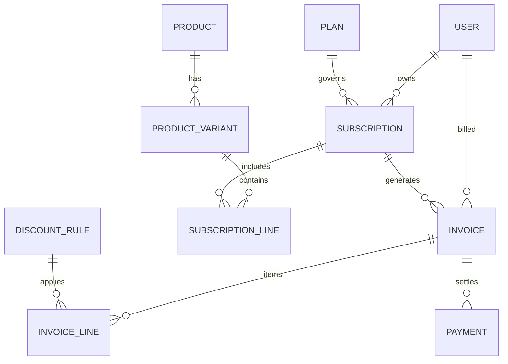

# Subscription Management System (Brightloop Software) - Analysis & Prior Art

## Document Source
- **File**: `C:\Users\Aaron\Downloads\Subscription_Management_System.pdf`
- **Origin**: Official **Odoo Hackathon / Hiring Challenge** problem statement (indicated by the Odoo brand product variant reference and 1:1 mirroring of Odoo's core subscription, invoicing, and sales modules).

---

## 1. Problem Statement Deconstruction

### Objective
Build a unified, full-lifecycle software platform for **Brightloop Software** to manage recurring SaaS subscriptions, automated billing cycles, quotations, payments, and financial analytics.

### Key Functional Modules
1. **Authentication & RBAC (3 Roles)**:
   - **Admin**: Full system control, manages staff, configures products, plans, taxes, and discount rules.
   - **Internal Staff**: Daily operations, quotes, subscription lifecycle, and customer communication.
   - **Customer Portal**: Self-service portal restricted strictly to the customer's own subscriptions and invoices.
   - Password policy: >8 characters, uppercase, lowercase, special character, password reset links.

2. **Product Catalog & Variant Matrix**:
   - Product attributes: Name, type, sales price, cost price, internal notes.
   - Product variants: Dynamic pricing modifiers (e.g., Brand attribute: Odoo brand adds +560 to base price).

3. **Subscription Plans**:
   - Pricing, billing frequencies (Daily, Weekly, Monthly, Yearly).
   - Minimum order quantity and availability date windows.
   - Lifecycle settings: Auto-close on expiry date, or allow early termination, pause, and renewal.

4. **Quotation-to-Subscription Pipeline**:
   - Reusable quotation templates (pre-filled product lines and validity periods).
   - Subscription record: Unique ID, customer, plan, start/expiry dates, payment terms, itemized product lines.
   - **State Machine**: `Draft` ➔ `Quotation` ➔ `Confirmed` ➔ `Active` ➔ `Closed`.

5. **Automated Billing Engine**:
   - Batch invoice generation on recurring billing dates.
   - Automated tax calculation from admin-defined tax rules.
   - **Invoice State Machine**: `Draft` ➔ `Confirmed` ➔ `Paid` (or `Cancelled`).
   - Idempotency guarantee: Zero duplicate billing and zero skipped billing.

6. **Discount Engine**:
   - Fixed amount or percentage discounts.
   - Constraints: Minimum spend/quantity, validity dates, maximum usage caps.
   - Scope: Specific products or entire subscriptions; automated invoice line application and automatic expiration.

7. **Payments & Accounts Receivable (A/R)**:
   - Payment recording: Method, amount, transaction date, notes mapped to target invoice.
   - Real-time aging: Identification of paid vs. outstanding vs. overdue invoices.

8. **Finance Lead Executive Dashboard**:
   - Metrics: Active Subscriptions, MRR/ARR, Total Revenue Collected, Accounts Receivable, Overdue Aging.
   - Performance requirement: Sub-2-second query response time across thousands of subscriptions.

---

## 2. Prior Art: Similar Older Problems in Make-A-Ton Archives

Within our analyzed catalog of **77 projects** across Make-A-Ton 2025 and Make-A-Ton 7.0, several projects solved direct subsets of this problem:

### A. Direct Architectural Matches

| Project Name | Edition & Team | Cloned Location | Matching Sub-problems Solved |
| :--- | :--- | :--- | :--- |
| **KOLPAY** | Make-A-Ton 2025 *(Team Kolon)* | [`repos_2025/16_KOLPAY`](repos_2025/16_KOLPAY) | **Ledger reconciliation & payment tracking**: Solved disconnected digital billing, dual-party ledger tracking, periodic account settlements, balance aging, and customer debt verification. |
| **SaveSense** | Make-A-Ton 2025 *(Team SaveSense)* | [`repos_2025/21_SaveSense`](repos_2025/21_SaveSense) | **Subscription tracking & recurring billing cycles**: Automated detection of recurring subscription cycles, automated renewal alerts, and financial leakage prevention. |
| **MediSure** | Make-A-Ton 7.0 *(Project 39)* | Devpost 7.0 | **Itemized billing & invoice states**: Rule-based invoice validation, itemized line calculation, tax rules, and multi-state invoice workflows (`Draft` ➔ `Confirmed` ➔ `Paid`). |
| **Snow** | Make-A-Ton 7.0 *(Project 17)* | Devpost 7.0 | **Enterprise state machine orchestration**: Moving multi-step transactional orders through sequential state transitions with automated error handling. |
| **Cusatify** | Make-A-Ton 2025 *(Team freshers.exe)* | [`repos_2025/6_Cusatify`](repos_2025/6_Cusatify) | **Multi-role customer portal & recurring dues**: Customer vs Admin portal segregation, recurring due dates, automated overdue penalty calculations, and fine notifications. |
| **MarketingWala** | Make-A-Ton 7.0 *(Project 1)* | [`repos_7_0/1_MarketingWala`](repos_7_0/1_MarketingWala) | **SaaS tiering & recurring billing**: Multi-tiered SaaS subscription models, automated periodic renewals, and role-based portal access. |

---

## 3. Classic Odoo Enterprise Challenge Precedents

In Odoo campus hackathons and enterprise challenge tracks (e.g. Odoo Combat, Make-A-Ton Enterprise Track), this problem represents the classic **"Quote-to-Cash (Q2C) Subscription Engine"**.

### Exact Mirroring of Odoo Core Modules:
1. `sale.subscription` ➔ Maps directly to Brightloop's subscription state machine.
2. `sale.order` ➔ Maps to the quotation template and quote conversion pipeline.
3. `account.move` ➔ Maps to the recurring billing invoice batch generator.
4. `product.template` & `product.product` ➔ Maps to product variants (base price + attribute price modifiers like Odoo brand +560).
5. `res.partner` ➔ Maps to customer portal accounts and staff RBAC.
6. `account.tax` & `loyalty.program` / `coupon` ➔ Maps to tax rules and discount logic.

---

## 4. Architectural Blueprint to Implement Brightloop System

### Tech Stack Recommendation (Sub-2s Response Guarantee):
- **Frontend**: React 19 + Vite + TailwindCSS + Shadcn UI (instant HMR, customer portal + admin ERP layout).
- **Backend**: Python FastAPI with async PostgreSQL (SQLAlchemy / asyncpg) with indexed queries on `(customer_id, status, next_billing_date)`.
- **Background Cron**: Celery / Redis or APScheduler for batch billing day generation.
- **Reporting Engine**: Materialized views or aggregated queries for instant MRR, ARR, and overdue calculation.
